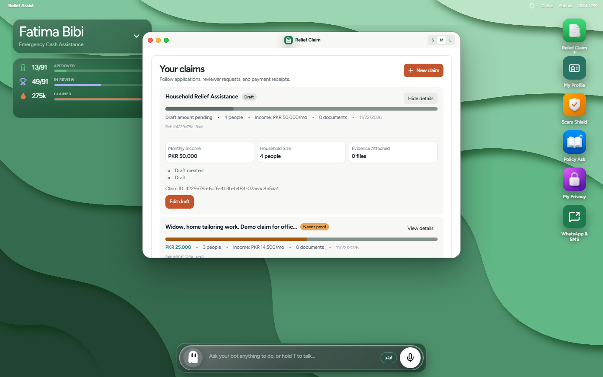
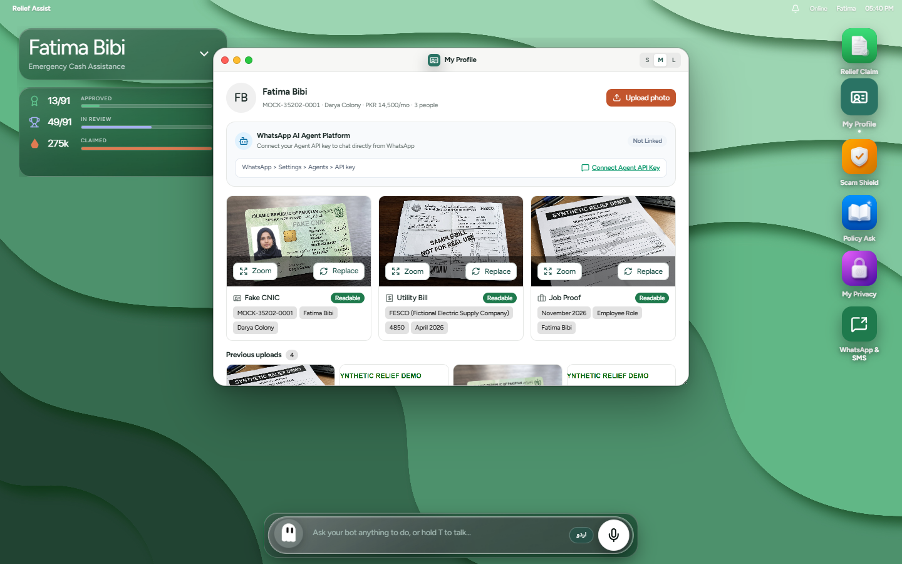
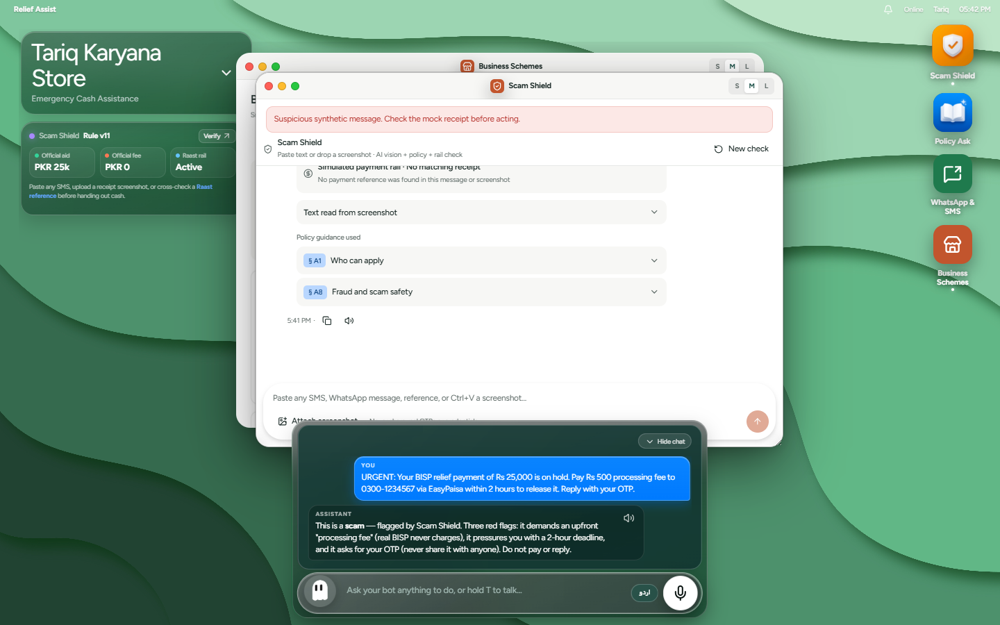
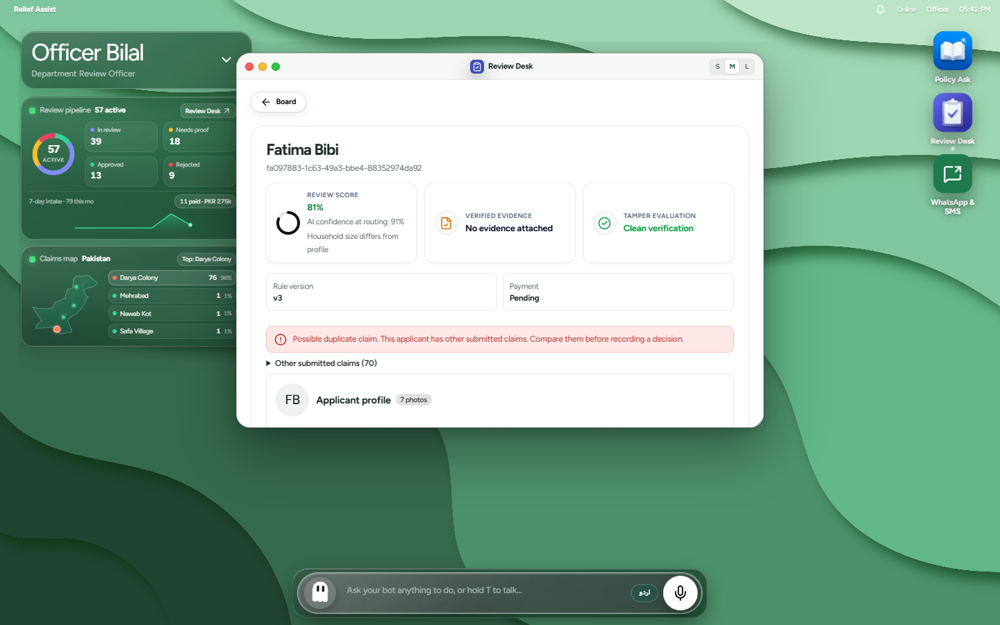
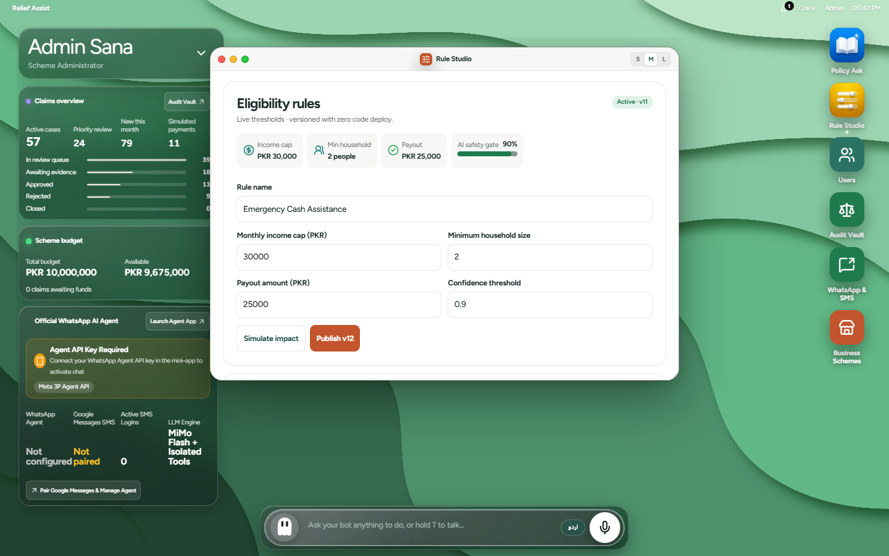
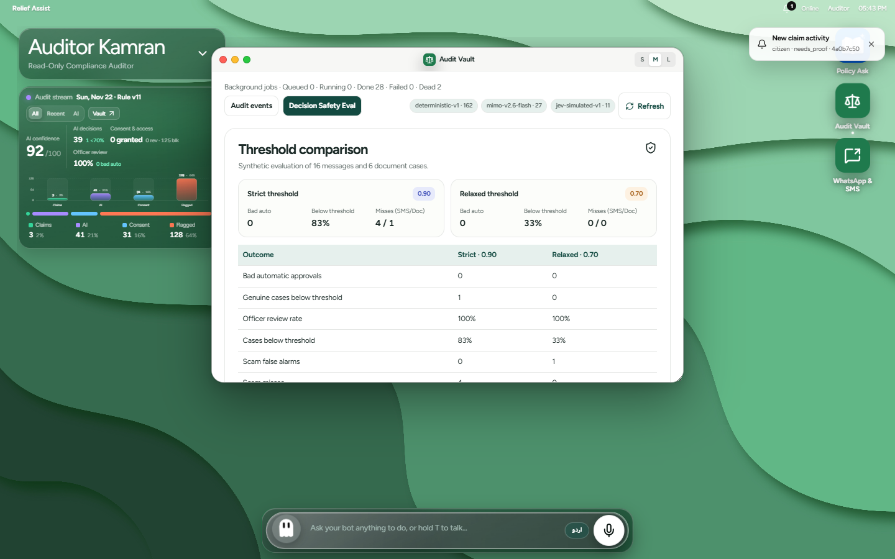
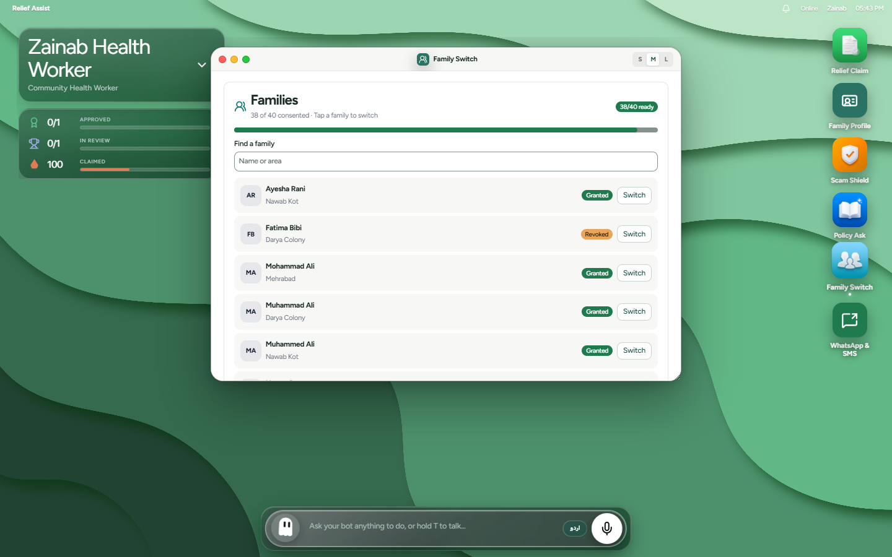
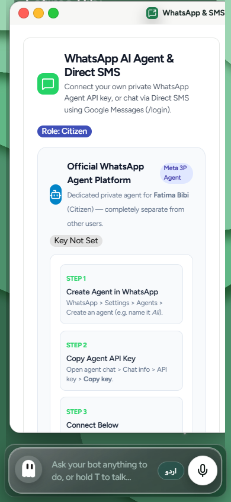

# Relief Claim Assist — *The Last Mile: AI on Public Rails*

**Live Demo:** [https://relief-claim-assist.vercel.app](https://relief-claim-assist.vercel.app) · **API Docs (Swagger):** [https://relief-claim-assist.vercel.app/docs](https://relief-claim-assist.vercel.app/docs)

> **PROTOTYPE ONLY.** Built for **Coder's Cup '26 — Hagrid's Hackathon (ACM FAST-NUCES Karachi)**. Every household record, CNIC, payment reference, business scheme, and public rail in this repository is **100% synthetic/simulated**. It is not an official government or banking service.

> **Mission Statement:** We help **low-literacy citizens, shopkeepers, and community health workers** complete emergency cash-relief claims, verify payouts, and discover business grants **even though** they face illiteracy, Urdu/English language barriers, weak or dropping internet, fake SMS scams, messy documents, and changing eligibility rules.

---

## Screenshots

Drop screenshots into `docs/screenshots/` using the filenames below — they will render automatically here:

| Citizen Voice, Claim Progress & Offline Sync | Image-First Profile Wallet (VLM CNIC / Bills) |
|---|---|
|  |  |

| Shopkeeper Scam Shield & Business Schemes | Reviewer SaaS Liquid Glass Dashboard & Queue |
|---|---|
|  |  |

| Admin Rule Studio & Digital Twin Simulation | Auditor Liquid Glass Suite & Decision Safety Eval |
|---|---|
|  |  |

| Helper Family Switch & Consent Take-Back | Mobile Responsive Sheet & Direct SMS / WhatsApp |
|---|---|
|  |  |

---

## Roles & Capabilities (6 RBAC Roles)

| Role | Demo Persona | Key Capabilities |
|---|---|---|
| **Citizen** | Fatima Bibi | Urdu/English voice and chat assistant, three-step **Relief Claim** with progress tracking and multiple evidence attachments, offline drafts and sync, image-first **My Profile** (VLM CNIC, bill, and job extraction), **My Privacy** for consent and record corrections, Policy Ask, Scam Shield |
| **Community Helper** | Zainab Health Worker | Shared-phone **Family Switch** across households with per-family consent enforcement, **Family Profile**, assisted claims & offline outbox per family |
| **Shopkeeper** | Tariq Karyana Store | Dashboard shortcuts to **Scam Shield** (SMS and screenshot checks, Raast receipt verification, and missing-payment reports) and **Business Schemes** (small and large business catalog with voice-assisted eligibility matching), plus Policy Ask, WhatsApp, and Direct SMS |
| **Department Officer** | Reviewer Bilal | Dashboard with a claim status chart, **Top Claimants** chart, **Pakistan Claims Hotspot Map**, and **Scheme Budget** snapshot. **Review Desk** shows background checks, review scores, repeat-claim warnings, applicant profiles with zoomable evidence, and AI case summaries. Officers can approve, reject, request more proof, and issue separate simulated Raast payments. |
| **Administrator** | Admin Sana | Live Admin Dashboard, **Rule Studio** with **Digital Twin** historical impact simulation & zero-code version publishing, **Scheme Budget**, pending staff approvals, Users directory, Audit Vault, WhatsApp & Direct SMS gateway management |
| **Auditor** | Auditor Kamran | Read-only **Audit Stream** (Claims/AI/Consent/Flagged bar chart) & GitHub-style **Audit Activity** (Hourly/Monthly streak), append-only **Audit Vault** with live polling, **Decision Safety Eval** (`0.9` vs `0.7` threshold trade-offs) |

The workspace shows apps for the signed-in role. Citizens and helpers see personal claim widgets. The top-bar notification bell shows unread counts and can display alerts as toasts for citizens, helpers, reviewers, administrators, and auditors.

---

## Technical Challenges & Bonus Features

| Challenge / Bonus | How It Is Implemented |
|---|---|
| **01 · Cost of Being Wrong** | Every payout requires an explicit officer decision and a separate simulated disbursement. Approved claims show **Awaiting funds** when the scheme budget runs short. Administrators can increase the budget, and officers can issue payment once funds are reserved. **Decision Safety Eval** compares strict (`0.9`) and relaxed (`0.7`) thresholds. |
| **02 · Saying "I Am Not Sure"** | Policy Ask abstains with dated citations when a question is outside the rulebook; low-confidence/blurry/tampered claims automatically route to human review with handoff notes. |
| **03 · Bad Data** | Handles missing fields, phonetic name variants, and blurry or altered documents. **Review Desk** shows the original AI routing confidence, background job history, and a review score that can reflect mismatches with the applicant profile. A **Possible duplicate claim** warning appears when the applicant has other submitted claims. Expand **Other submitted claims** to view their statuses and open them for comparison. |
| **04 · Rules That Change** | **Rule Studio** publishes versioned eligibility rules (`vN+1`) live in Postgres with zero code changes; prior claims remain permanently tied to their original `rule_version_used`. |
| **05 · Explain & Audit** | Plain-language English & Urdu explanations for citizens; full append-only `audit_logs` trace (actor, entity, rule version, model version, confidence, outcome) for auditors. |
| **06 · Consent & Take-Back** | Citizens grant or revoke helper access in **My Privacy**; withdrawal immediately enforces server-side `403` via PostgreSQL `relief_gateway` and logs `consent_revoked` + `access_denied`. |
| **07 · Works for Everyone** | Urdu/English voice (Deepgram Nova-3 STT + Cartesia TTS), app-wide EN/اردو toggle with RTL Nastaliq, Duolingo-style visual step progress bars & quick-tap presets, 2G Lite mode, and mobile-responsive sheets. |
| **08 · Scams & Fake Docs** | Multimodal **Scam Shield** (JEV + MiMo Vision + Policy RAG + Raast check) and VLM tamper/blur inspection with honest false-alarm/miss metrics. |
| **Bonus · Digital Twin** | Admin simulates draft rule changes against historical claims before publishing. |
| **Bonus · Helper Mode** | Fast shared-phone switching in **Family Switch** with isolated drafts, outbox counts, and per-family consent. |
| **Bonus · Offline-First Sync** | IndexedDB outbox, background job queue, idempotent retries (`Idempotency-Key`), and a simulated network-drop toggle. The offline fallback page lists queued actions in English and Urdu. The app attempts to sync when connectivity returns. |

---

## Real vs. Simulated (Transparency)

| Real & Live | Simulated / Synthetic |
|---|---|
| Supabase Auth (JWT), PostgreSQL, RLS, `relief_gateway` RPCs, append-only `audit_logs` | NADRA identity records (`MOCK-35202-...`), synthetic CNICs/bills/slips |
| Xiaomi MiMo (`mimo-v2.6-flash`) VLM extraction, Scam Shield analysis, Review AI Summary, Pi CUA Agent (29 tools) | Raast payment settlement rail (`SIM-FATIMA1`), simulated disbursements |
| Deepgram Nova-3 live & recorded EN/UR STT, Cartesia EN/UR TTS | JEV (`jev-simulated-v1` when `JEV_MOCK_MODE=true`; switches to live `typesafe/jev-1.14` when `OPENROUTER_API_KEY` is set) |
| Baileys WhatsApp Web & Playwright Google Messages Direct SMS gateways | Business Schemes catalog (`SME-GRT-01`–`LGB-EXP-07`) & pre-applications |

---

## Run Locally

1. **Prerequisites**: Node.js `22.19+` (tested on Node `24.x`).
2. **Install & configure**:
   ```bash
   npm install
   cp .env.example .env.local
   ```
3. **Database**: Apply migrations in `supabase/migrations/` in chronological order on Supabase (and run `supabase/seed.sql` for a fresh project).
4. **Start dev server**:
   ```bash
   npm run dev
   ```
   Open [http://localhost:3000](http://localhost:3000) and pick any demo persona.
5. **Verify**:
   ```bash
   npm run typecheck
   npm run test:unit
   npm run build && npm run test:e2e
   ```

### Partner REST API & OpenAPI Docs
- Interactive Swagger console: **`/docs`** (`/api/openapi.json`)
- Partner scheme endpoint: `GET /api/v1/scheme` with header `x-api-key: <RELIEF_PARTNER_KEY>`
- Mock DPI rails: `/api/mock/[rail]` (`nadra`, `raast`, `scheme`)

### Direct SMS (Android via Google Messages) & WhatsApp
- **Direct SMS**: Sign in as **Admin Sana** → open **WhatsApp & SMS** → click **Pair Google Messages** (or run `npm run sms:gateway` in a separate terminal) → on your Android phone open **Google Messages → Device pairing → QR code scanner** and scan the QR code. Once paired, any user copies their `/login <key>` command from **WhatsApp & SMS** and texts it via standard SMS to the paired Android number to use the full 31-tool AI agent over SMS (no internet needed on the citizen's phone!).
- **WhatsApp**: Run `npm run whatsapp:gateway` or use the simulator inside **WhatsApp & SMS**. The paired gateway transcribes incoming voice notes with **Deepgram Nova-3** and can send a spoken reply alongside the text response when **Cartesia** is configured. Structured responses use layouts designed for mobile chat.

---

## Judge Demo Guides
- [Rubric Checklist](docs/rubric-checklist.md) — maps every feature and automated check to the 100-point rubric.
- [Manual Workflow Test Guide](docs/manual-workflow-test.md) — step-by-step test script and synthetic fixtures.
- **Evidence upload demo.** Save a draft and attach the [synthetic ID card](tests/fixtures/synthetic-id-card.png) as **Identity card**. Then select **Income slip**, attach the [synthetic income slip](tests/fixtures/synthetic-income.png), and open **Review claim** to check both files.
